<div align="center">

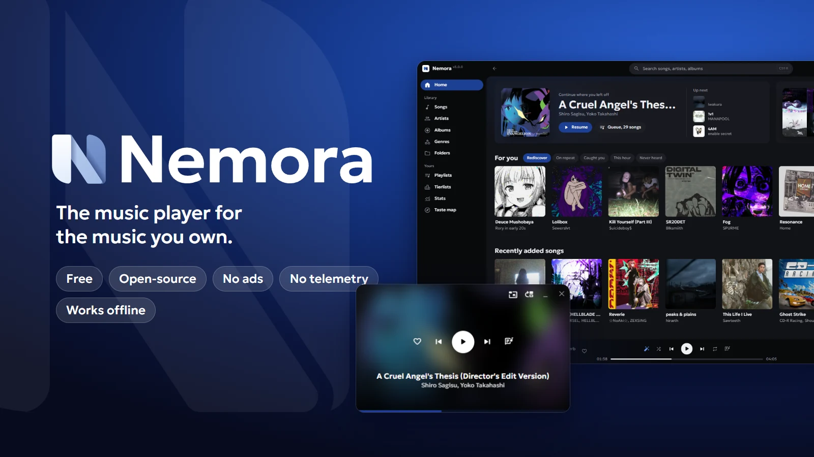

<br>

<a href="https://github.com/Nikenmar/Nemora/releases/latest">
  
</a>

</div>

Nemora plays the music on your own computer: your files, your folders, your tags. No account, no stream, no ads. It is built around one idea, that a player you use every day should get to know your taste and show you what it learned.

## Why Nemora

- **Its own audio engine.** Written in Rust, it decodes every file itself. At full volume with the equalizer flat, a file reaches Windows sample for sample; one track runs into the next without a gap.
- **It learns how you listen.** Tierlists, duels, what you replay and what you skip all feed Smart Shuffle, and it tells you why each song comes next.
- **Songs keep their history.** A song is recognised by its audio, not by its path or tags, so renaming, retagging or moving a file keeps every listen, rating and tier.
- **Private by design.** No telemetry, no analytics, no account. Settings › About › Privacy lists every request Nemora makes and when.

## Features

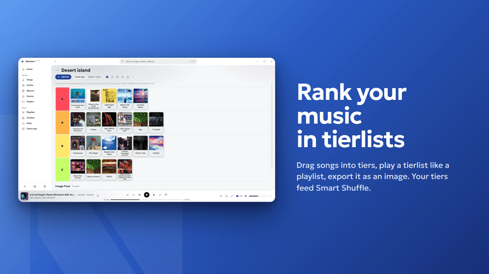

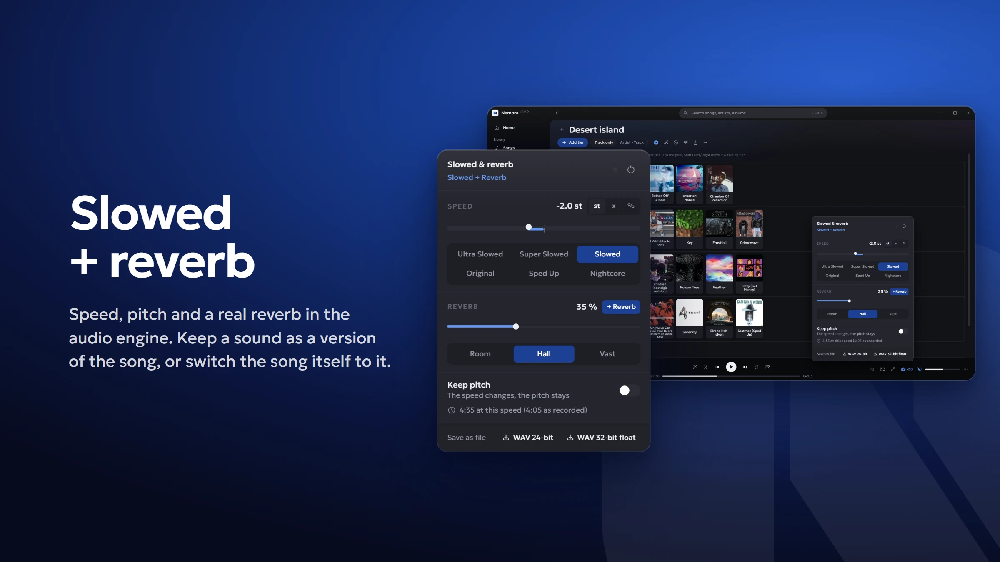

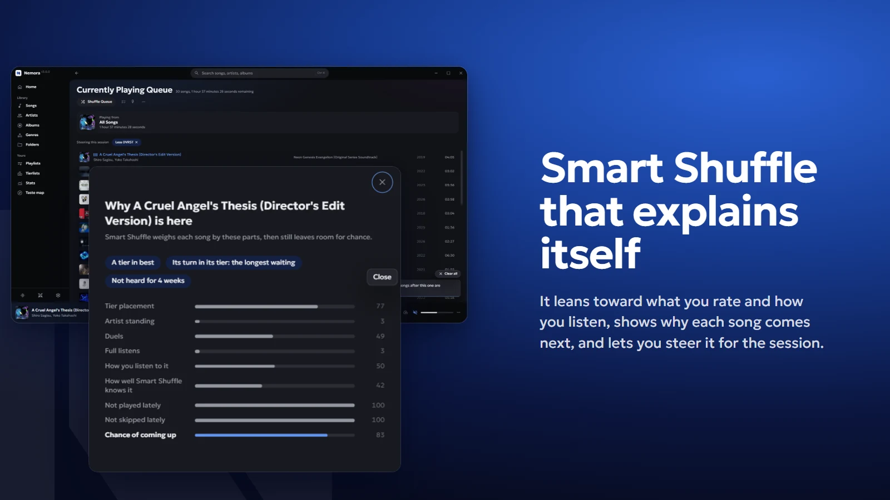

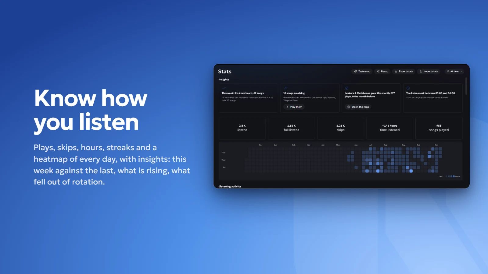

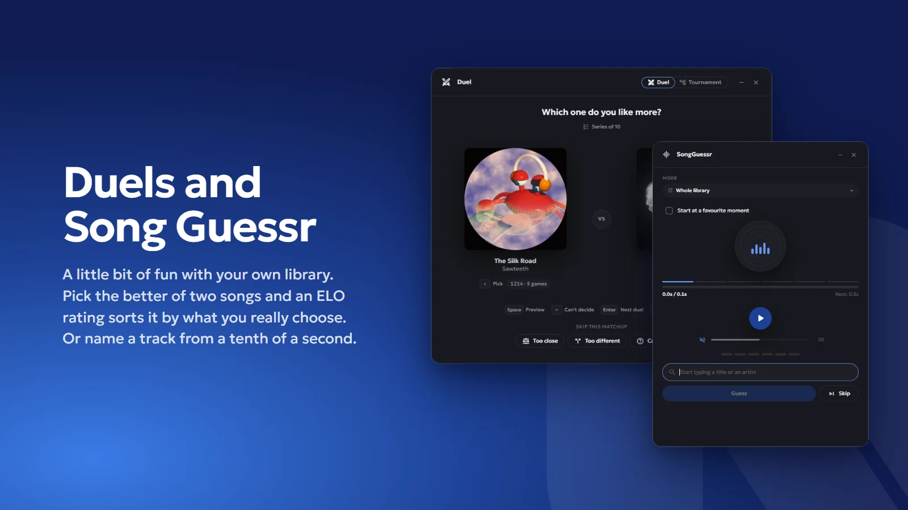

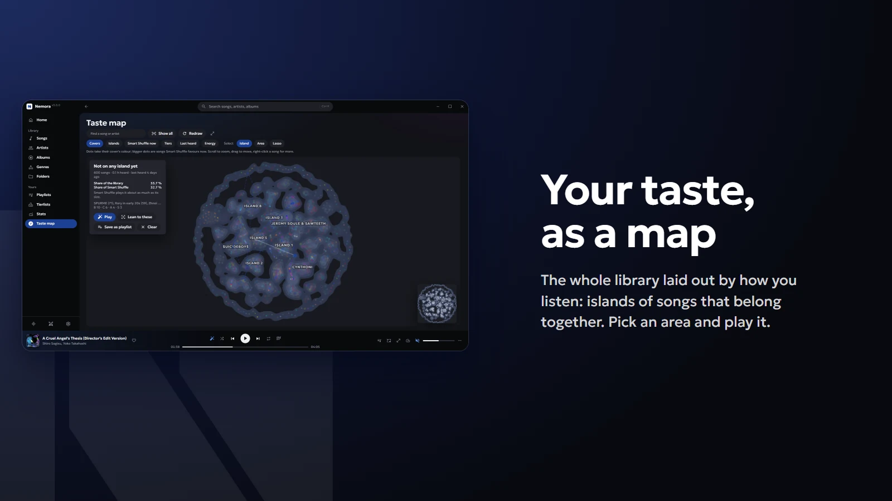

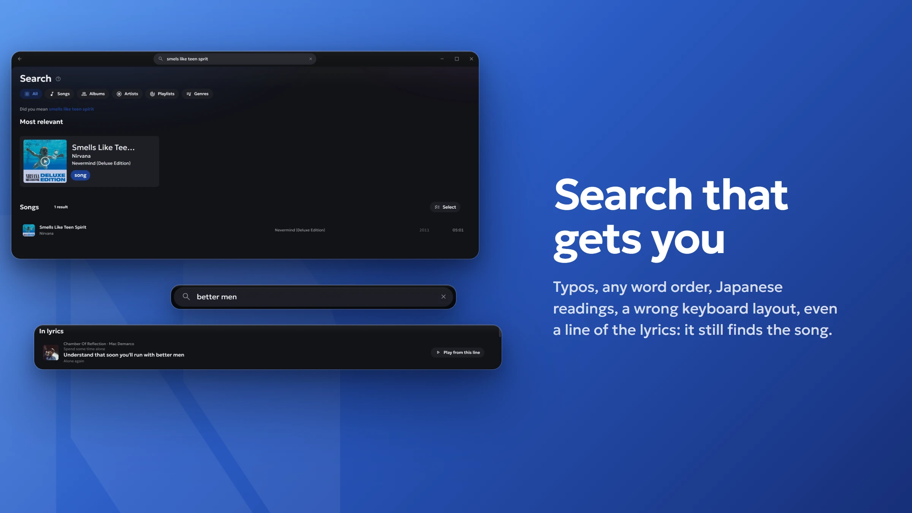

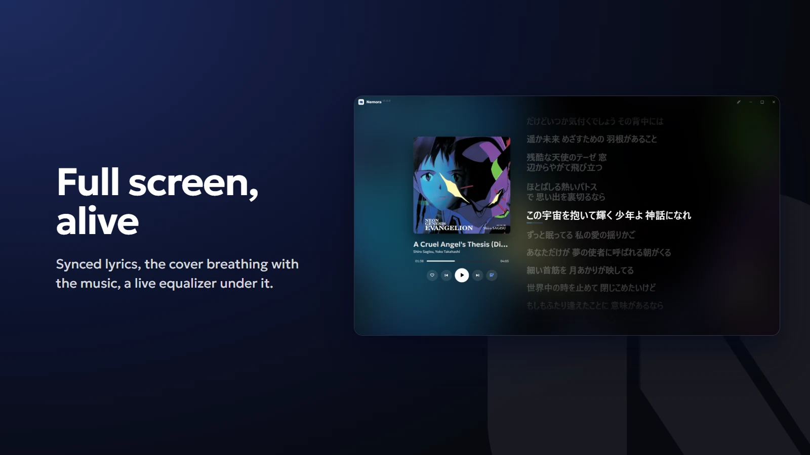

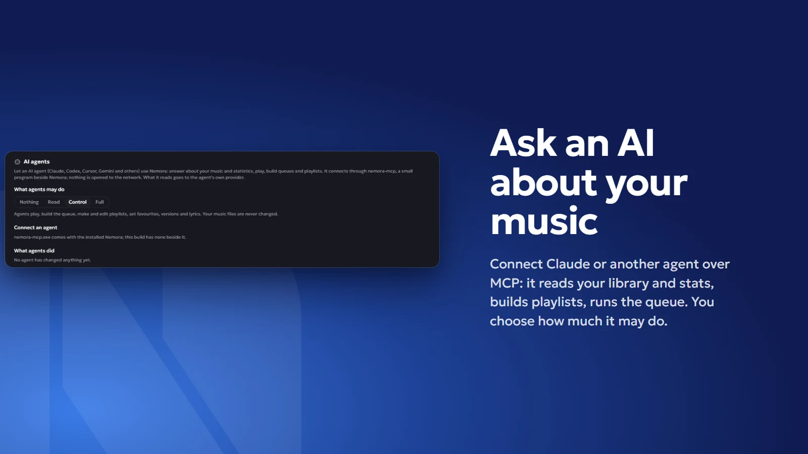

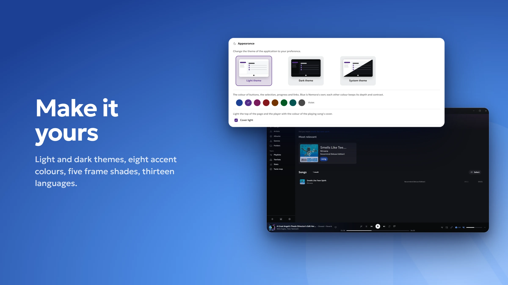

### And more

- **For you.** The mix of the day, Rediscover (songs you love but have not heard in a while), On repeat, Never heard, each one a click from a playlist.
- **Lyrics.** Synced lyrics from your files or LRCLIB, optionally Musixmatch, fetched for the whole library in the background if you want; search by a line, share a line as a card, translate.
- **Tournaments.** Seed 8, 16 or 32 songs and play the bracket down to one winner.
- **Versions.** Keep a slowed, sped-up or reverb sound as its own row, or save it as a WAV with the song's tags and cover.
- **Headphone correction.** Pick your headphones from the AutoEQ list, or import a profile, on top of the equalizer.
- **Smooth volume.** A perceptual curve like the Windows mixer, not a linear slider.
- **Import from Spotify.** Paste a public playlist link; its tracks are matched against your library.
- **Last.fm and Discord.** Scrobbling, now playing and loves; your song as your Discord status.
- **OBS widget.** A transparent now-playing overlay, served only to your own computer.
- **Mini player, tag editor, drag a song out** into Explorer, a DAW or a chat.

## Download

Get the installer from [Releases](https://github.com/Nikenmar/Nemora/releases/latest). Windows 10 and 11, x64. Nemora checks for updates and installs one only when you agree.

## Building

```
cargo test
cd apps/desktop && npm install && npm run tauri dev
```

Development builds keep their data in `%APPDATA%\Nemora-dev`; `NEMORA_PROFILE_DIR` overrides it. The README pictures are made from real shots of the app by `tools/readme/compose.py`.

## Credits

Made with [Rust](https://www.rust-lang.org), [Tauri](https://tauri.app) and [React](https://react.dev). Audio by [Symphonia](https://github.com/pdeljanov/Symphonia) and [Signalsmith Stretch](https://github.com/Signalsmith-Audio/signalsmith-stretch). Lyrics from [LRCLIB](https://lrclib.net) and [Musixmatch](https://www.musixmatch.com), artist info from [Deezer](https://www.deezer.com) and [Genius](https://genius.com), scrobbling via [Last.fm](https://www.last.fm), headphone profiles from [AutoEQ](https://github.com/jaakkopasanen/AutoEq). Every third-party licence is listed in **Settings › About › Open-source licenses**.

---

<div align="center">

Made by nikenmar, CMR

<sub>All songs, artists, albums and cover art shown are the property of their respective owners and appear for illustration only.</sub>

</div>
